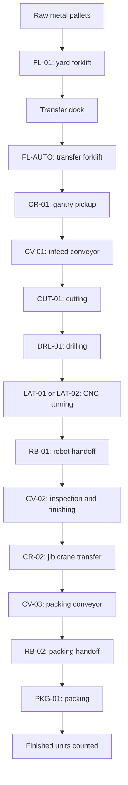
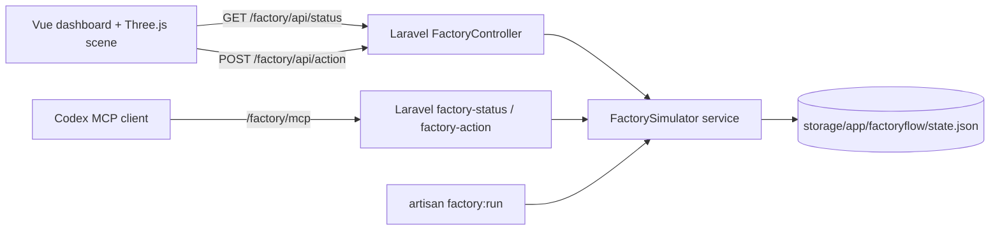

# FactoryFlow AI

**Autonomous manufacturing simulator built with Laravel, Vue 3, Three.js and the Model Context Protocol (MCP).**

FactoryFlow AI is a local, browser-based demonstration of a manufacturing factory. A Laravel simulation engine coordinates forklifts, crane lifts, conveyor drives, CNC machines, robot handoffs, inspection and packing. A Three.js scene visualises the same tracked workpiece, while a Vue dashboard provides live production status and controls. Codex can inspect and control the *virtual* factory through a separate Laravel MCP server.

> **Project status:** Development demonstration — **v5.1 (synchronised production and motion fix)**. This is not an industrial control system, a production-ready digital twin or a physical machine controller. All workpieces, pallets, faults and machines are simulated.
>
> **Deployment:** Local Windows development only. Both web and MCP endpoints should remain bound to `127.0.0.1`. This prototype does not include authentication suitable for internet or shared-network deployment.

## Screenshots

The following screenshots are stored relative to this README in `public/images/`.

### Factory floor — overview


### Factory floor — alternate camera angle


### AI activity and tracked workpiece


**Image filenames:** These links match the three supplied screenshots. If you renamed the files on your PC, either restore the filenames above or change the Markdown links to match the names in `public/images/`. All paths are relative to the project root so they also work in a future GitHub README.

## Contents

1. [Features](#features)
2. [Requirements](#requirements)
3. [Installing an existing complete FactoryFlow project](#installing-an-existing-complete-factoryflow-project)
4. [Rebuilding from the original Laravel MCP repository](#rebuilding-from-the-original-laravel-mcp-repository)
5. [Starting and stopping FactoryFlow](#starting-and-stopping-factoryflow)
6. [User manual](#user-manual)
7. [How the automated production works](#how-the-automated-production-works)
8. [Connecting Codex through MCP](#connecting-codex-through-mcp)
9. [Testing and development](#testing-and-development)
10. [Data, backups and resets](#data-backups-and-resets)
11. [Troubleshooting](#troubleshooting)
12. [Architecture and file map](#architecture-and-file-map)
13. [Security and known limitations](#security-and-known-limitations)

## Features

- **3D factory floor:** orbit/rotate and zoom around the factory with Three.js.
- **Autonomous material flow:** yard forklift `FL-01`, transfer forklift `FL-AUTO`, pallet dock and gantry pickup.
- **Cranes and robots:** gantry crane `CR-01`, jib crane `CR-02`, robots `RB-01` and `RB-02` moving as part of the workpiece sequence rather than continuously waving.
- **Machining:** laser cutter `CUT-01`, drill `DRL-01`, CNC turning centres `LAT-01`/`LAT-02`, inspection `QC-01`, finishing/assembly `ASM-01` and automatic packing `PKG-01`.
- **Conveyors:** three controllable drives (`CV-01`, `CV-02`, `CV-03`), each with start/stop and a speed setting from 0–100%.
- **Production orders:** queued, running, paused, complete or cancelled jobs, with progress and the ability to queue completed orders again.
- **Live dashboard:** cumulative units manufactured, running jobs, active machinery, estimated throughput, stock locations and alerts.
- **Safety controls:** stop factory, simulated emergency stop, fault injection and fault clearing.
- **MCP integration:** Codex can read the simulator status and perform supported simulation actions without modifying the original read-only file MCP server.
- **Persistent demo state:** local JSON state guarded by an exclusive lock; no separate database is required for the factory simulation itself.

## Requirements

| Software | Requirement / notes |
| --- | --- |
| Operating system | Windows 10/11 with PowerShell, as used for this project |
| PHP | **8.4+ recommended** for the original repository's locked development dependencies; the original `composer.json` declares `^8.3` |
| Composer | Installed and available in PowerShell |
| Node.js and npm | A Node.js version compatible with the installed Vite 7 build (e.g. current supported Node 20.19+ or 22.12+) |
| Browser | Up-to-date Chrome, Edge or Firefox with WebGL enabled |
| GPU | Hardware-accelerated graphics recommended for Three.js |
| Codex | Optional; needed only to demonstrate MCP-driven operation |
| Database | **Not required for the simulator's current JSON state**; any other Laravel functionality may have its own database requirements |

Confirm your development tools:

```powershell
php -v
composer --version
node -v
npm -v
```

The commands below use `E:\FactoryFlow-AI` as the project directory and port `8123`, matching the development installation.

## Installing an existing complete FactoryFlow project

**Use this route if you already have the full FactoryFlow source files**, whether copied from another PC or eventually downloaded from its own repository. The original `laravel-mcp-file-server` repository by itself does **not** contain all FactoryFlow upgrades.

1. Copy the **complete project source** into `E:\FactoryFlow-AI`. Do not copy `vendor/` or `node_modules/` if you intend to restore dependencies locally.
2. Open PowerShell and install backend and frontend dependencies:

   ```powershell
   Set-Location E:\FactoryFlow-AI
   composer install
   npm install
   ```

3. Create your environment file **only if it does not already exist**:

   ```powershell
   if (!(Test-Path .env)) {
       Copy-Item .env.example .env
       php artisan key:generate
   }
   ```

4. Set these entries in `.env` (preserve any unrelated application configuration):

   ```dotenv
   APP_NAME="FactoryFlow AI"
   APP_URL=http://127.0.0.1:8123
   ```

5. Clear stale Laravel caches, build the factory frontend and verify the routes:

   ```powershell
   php artisan optimize:clear
   npm run build
   php artisan route:list --path=factory
   ```

6. Run the tests:

   ```powershell
   php artisan test
   node --test tests/js/factory-motion.test.mjs
   ```

7. [Start the two application processes](#starting-and-stopping-factoryflow).

**Migrating saved demo progress:** If moving from another machine, separately copy `storage/app/factoryflow/state.json` while the simulator is stopped. It is local demo data, not part of the application source. Keep the old file backed up before replacing one.

## Rebuilding from the original Laravel MCP repository

**Use this only when FactoryFlow source is not yet available as one complete project.** The base GitHub project is [tuckbloor/laravel-mcp-file-server](https://github.com/tuckbloor/laravel-mcp-file-server); the factory was added through successive local upgrade packages.

### 1. Install the original Laravel MCP application

```powershell
Set-Location E:\
git clone https://github.com/tuckbloor/laravel-mcp-file-server.git FactoryFlow-AI
Set-Location E:\FactoryFlow-AI
composer install
npm install
Copy-Item .env.example .env
php artisan key:generate
```

If Git tracking is **not wanted** for this separate project, you may remove just the new clone's metadata:

```powershell
Remove-Item -Recurse -Force .git
```

Do **not** remove `.git` from an existing source repository unless you're deliberately discarding its local history. The original GitHub repository will not be deleted.

### 2. Apply the FactoryFlow packages, oldest to newest

You must have the respective upgrade ZIP files available in your Downloads folder. Extract each into its indicated *subdirectory*, then run its install script. **Don't run all steps against a currently running factory.**

| Order | Package | Installation script |
| --- | --- | --- |
| 1 | `FactoryFlow-AI-Starter.zip` | `scripts/install-factoryflow.ps1` (extract into project root) |
| 2 | `FactoryFlow-Machinery-Upgrade.zip` | `machinery-upgrade/scripts/apply-machinery-upgrade.ps1` |
| 3 | `FactoryFlow-CNC-Forklift-Upgrade.zip` | `production-upgrade/scripts/apply-production-upgrade.ps1` |
| 4 | `FactoryFlow-Autonomous-Upgrade.zip` | `autonomous-upgrade/scripts/apply-autonomous-upgrade.ps1` |
| 5 | `FactoryFlow-Synchronised-Upgrade.zip` | `synchronised-upgrade/scripts/apply-synchronised-upgrade.ps1` |
| 6 | `FactoryFlow-Motion-Fix-v5.1.zip` | `motion-fix/scripts/apply-motion-fix.ps1` |

```powershell
$root = 'E:\FactoryFlow-AI'
$downloads = Join-Path $env:USERPROFILE 'Downloads'

# 1 — Base factory starter: extracted directly into Laravel root.
Expand-Archive "$downloads\FactoryFlow-AI-Starter.zip" $root -Force
powershell -ExecutionPolicy Bypass -File "$root\scripts\install-factoryflow.ps1"

# 2 — Cranes, robots and machinery.
Expand-Archive "$downloads\FactoryFlow-Machinery-Upgrade.zip" "$root\machinery-upgrade" -Force
powershell -ExecutionPolicy Bypass -File "$root\machinery-upgrade\scripts\apply-machinery-upgrade.ps1"

# 3 — CNC lathes and forklifts.
Expand-Archive "$downloads\FactoryFlow-CNC-Forklift-Upgrade.zip" "$root\production-upgrade" -Force
powershell -ExecutionPolicy Bypass -File "$root\production-upgrade\scripts\apply-production-upgrade.ps1"

# 4 — Automatic production runner and navigation.
Expand-Archive "$downloads\FactoryFlow-Autonomous-Upgrade.zip" "$root\autonomous-upgrade" -Force
powershell -ExecutionPolicy Bypass -File "$root\autonomous-upgrade\scripts\apply-autonomous-upgrade.ps1"

# 5 — Synchronised, tracked metal-part handoffs.
Expand-Archive "$downloads\FactoryFlow-Synchronised-Upgrade.zip" "$root\synchronised-upgrade" -Force
powershell -ExecutionPolicy Bypass -File "$root\synchronised-upgrade\scripts\apply-synchronised-upgrade.ps1"

# 6 — Conveyor boundaries and smooth part animation.
Expand-Archive "$downloads\FactoryFlow-Motion-Fix-v5.1.zip" "$root\motion-fix" -Force
powershell -ExecutionPolicy Bypass -File "$root\motion-fix\scripts\apply-motion-fix.ps1"
```

Each patch includes its own prerequisites and checks. **Stop if any script reports a failure**; inspect the error before applying the next upgrade. Re-run `php artisan test` and `npm run build` once all upgrades are installed.

> **For a future public release:** Replace this multi-ZIP history with a consolidated, tested FactoryFlow AI repository. Cloning the original file-server repository will always be a different starting point until that happens.

## Starting and stopping FactoryFlow

FactoryFlow currently needs **two separate PowerShell windows**. The Laravel web server hosts the browser interface/API; the factory worker advances the simulation even when nobody has the dashboard open.

### PowerShell window 1 — Laravel

```powershell
Set-Location E:\FactoryFlow-AI
php artisan serve --host=127.0.0.1 --port=8123
```

### PowerShell window 2 — simulation worker

```powershell
Set-Location E:\FactoryFlow-AI
php artisan factory:run --interval=100
```

Use only **one** factory worker instance. Running duplicates is unnecessary, even though the underlying JSON state uses an exclusive lock.

### Open the dashboard

**<http://127.0.0.1:8123/factory>**

Press **Ctrl+F5** after installing a new frontend build. If the worker is running but production is stopped, the screen will remain stationary until you press **START FACTORY**.

### Stop the application

1. Press **STOP FACTORY** in the UI to preserve the current part and job positions.
2. Press `Ctrl+C` in the simulation-worker PowerShell window.
3. Press `Ctrl+C` in the Laravel PowerShell window.

For an upgrade, stop **both terminal processes first**. Do not delete the simulation state merely to stop the factory.

## User manual

### 1. Global factory controls

The control strip appears above the current dashboard view.

| Control | What it does |
| --- | --- |
| **START FACTORY** | Enables conveyors and handling equipment, resumes a paused order, or schedules the next queued order. If all orders are already complete, begins another run of the demo jobs. |
| **STOP FACTORY** | Stops factory progression and equipment while retaining the current production state. Press START to resume. |
| **RESTART PRODUCTION** | Starts a **new production cycle** by resetting each order's current progress; **lifetime units manufactured are retained**. Requires confirmation. |
| **EMERGENCY STOP** | Stops the simulated factory and sets its emergency-stop flag. |
| **RELEASE E-STOP** | Clears the emergency-stop flag; **press START FACTORY afterward** to resume. |
| **Repeat orders automatically** | When checked, another cycle is scheduled after all current orders finish. In the v5.1 initial state this is **off**. |
| **Reset entire demo** | Restores demo jobs, equipment, material levels and **all production totals** to initial values. This is a destructive reset and requires confirmation. |

**Recommended first-run sequence:** Open `/factory` → verify the factory is stopped → leave **Repeat orders automatically** unticked → select **START FACTORY** → watch `TRACKED METAL PART` and the forklifts/crane → open **AI Activity** to confirm the handoffs → return to Factory Floor.

### 2. Left navigation

All eight sidebar items switch to functioning views:

| Page | Purpose |
| --- | --- |
| **Factory Floor** | Interactive 3D model, headline figures, production orders, automatic material supply and conveyor drive controls. |
| **Dashboard** | Production performance, processed material counts and per-job progress. |
| **Production Jobs** | Job queue, quantity manufactured, statuses, priority and supported job actions. |
| **Machines** | CNC/processing stations, temperatures, faults, robots, cranes, forklifts and handling-equipment speeds. |
| **Conveyors** | Separate start/stop and speed controls for `CV-01`, `CV-02` and `CV-03`. |
| **Inventory** | Pallet quantities at the raw yard, transfer dock and crane bay, open blanks and dispatched items. |
| **Alerts** | Active machine faults, simulated emergency stop and alert history. |
| **AI Activity** | Timestamped events for production and UI/MCP actions. |

### 3. Using the 3D factory scene

- **Drag** inside the 3D view to rotate the camera.
- **Scroll** over the view to zoom in/out.
- Watch the **tracked workpiece** rather than expecting all machines to move all the time. Equipment is intended to run only during the relevant stage.
- `RUNNING` at factory level does not mean every machine must be operating simultaneously. In the current single-piece flow, the **MACHINES RUNNING** figure may be `0/7` during a crane or conveyor transfer.
- Metal parts may look simplified: machinery geometry is procedurally built in Three.js rather than imported from industrial CAD models.

### 4. Production jobs

Default demonstration orders after a full reset:

| Job | Product | Quantity | Priority |
| --- | --- | ---: | --- |
| `JOB-1001` | Turned Steel Shaft | 50 | High |
| `JOB-1002` | Aluminium Coupling | 30 | Medium |
| `JOB-1003` | Brass Bush | 100 | Low |

Each job includes its ID, product, produced/required count, status and action button. The current implementation supports these transitions:

- **Start job:** `queued` → `running`.
- **Pause:** `running` → `paused` (also stops the current factory operation).
- **Resume:** `paused` → `running`.
- **Queue again:** `complete` or `cancelled` → `queued`, resets that order's current produced quantity.
- **Cancel:** A supported backend action for queued/running/paused jobs; not all controls are shown on every screen.

Only packed workpieces count as finished production. The **UNITS MANUFACTURED** figure is cumulative, while an order's progress represents its current run.

### 5. Conveyors

Open **Conveyors** or the **Conveyor drives** panel on the Factory Floor.

1. Choose the drive: `CV-01`, `CV-02` or `CV-03`.
2. Use **Start** or **Stop** for that conveyor.
3. Adjust its slider between **0% and 100%** (in the UI, steps of 5%).
4. Watch the relevant conveyor and tracked part. Production may pause when a required conveyor is stopped or set to zero.

The v5.1 frontend motion fix keeps `CV-02`'s reverse-moving markers within the belt and smooths workpiece movement between server updates.

### 6. Machines, cranes, robots and forklifts

Open **Machines** to see equipment status and controls.

| Equipment | Role |
| --- | --- |
| `FL-01` | Autonomous yard forklift delivering raw pallets to the transfer dock. |
| `FL-AUTO` | Autonomous forklift transferring pallets to the gantry bay. |
| `CR-01` | Gantry crane lifting an individual blank onto the infeed route. |
| `CV-01` | Conveyor feeding cutting/drilling and CNC infeed. |
| `CUT-01`, `DRL-01` | Initial machining stages. |
| `LAT-01`, `LAT-02` | Alternating CNC turning centres. |
| `RB-01` | Transfers turned parts to the next conveyor. |
| `CV-02`, `QC-01`, `ASM-01` | Inspection and finishing route. |
| `CR-02` | Transfers the workpiece across conveyor lanes. |
| `CV-03`, `RB-02`, `PKG-01` | Final conveyor, packing robot and packing station. |

Handling equipment exposes **Start/Stop** and **Speed** controls. Machines expose **Simulate fault** and **Clear fault**. Simulated faults can interrupt production until cleared; see the Alerts page.

**Important:** Although the current state structure still contains legacy manual forklift actions for testing, **both forklifts operate autonomously when FactoryFlow is running**. You should not have to drive them by hand.

### 7. Inventory and material supply

- Each virtual pallet contains **20 metal blanks**.
- The yard forklift moves pallets to the dock when material is required.
- The transfer forklift takes dock pallets to the gantry crane.
- The gantry opens a pallet and loads individual blanks into production.
- The simulator can replenish raw stock with **virtual inbound deliveries**, so this is not a real purchasing/inventory reconciliation system.
- **RAW PALLETS**, **AT DOCK** and **CRANE BAY** show stock at different locations; **DISPATCHED PARTS** and **UNITS MANUFACTURED** do not necessarily use the same reporting scope.

### 8. Alerts and production recovery

If production appears to stop:

1. Open **Alerts** to check machine faults or an active E-stop.
2. Clear any simulated machine fault with **Clear fault**.
3. If E-stop is engaged, press **RELEASE E-STOP**.
4. Return to the controls and press **START FACTORY** if needed.
5. Verify the required conveyors, cranes and robots are enabled and have non-zero speeds.
6. Check **AI Activity** for the last completed handoff.

### 9. AI Activity

This screen is an event history rather than a chat window. Entries include workpiece allocation, crane pickup, robot transfers, packed parts, job scheduling, speed changes, faults and factory commands. UI and MCP actions both affect the same stored simulation state.

## How the automated production works

The v5.1 simulator tracks **one workpiece at a time** through a staged, server-authoritative route:



An equipment animation should correspond to a production stage: pickup → lift → travel → place → retract. The unit counter increases only after the part is packed. **This is still a simplified one-part-at-a-time demonstration**, not a multi-line physics or G-code-based production system.

## Connecting Codex through MCP

FactoryFlow has **two different MCP endpoints**:

| Endpoint | Purpose |
| --- | --- |
| `http://127.0.0.1:8123/mcp` | Original Laravel MCP file server — read-only file tools. |
| `http://127.0.0.1:8123/factory/mcp` | FactoryFlow tools — read and change **simulated** factory state. |

Register the factory endpoint in a **third PowerShell window** (Laravel must already be running):

```powershell
codex mcp add factoryflow-controls --url http://127.0.0.1:8123/factory/mcp
codex mcp list
```

If it is already registered, **do not add it again**. Restart Codex to load the configuration. The original file-server registration can coexist with this factory-specific endpoint, but there is no need to register the *same* URL twice.

### Available factory tools

| MCP tool | Purpose | Arguments |
| --- | --- | --- |
| `factory-status` | Read live jobs, machinery, production state, material flow and events. | None |
| `factory-action` | Perform a supported factory simulation operation. | `action` (required), `id` and `speed` as applicable |

Example actions include:

| `action` | `id` | `speed` | Meaning |
| --- | --- | ---: | --- |
| `start_factory` | — | — | Start automatic factory production |
| `stop_factory` | — | — | Stop and preserve the current state |
| `restart_production` | — | — | Requeue orders but retain cumulative production |
| `set_auto_repeat` | — | `1` / `0` | Enable/disable order repetition |
| `set_conveyor_speed` | `CV-02` | `65` | Set conveyor 2 to 65% |
| `stop_conveyor` | `CV-01` | — | Stop conveyor 1 |
| `start_handling` | `CR-01` | — | Enable the gantry crane |
| `set_handling_speed` | `RB-01` | `60` | Set robot speed |
| `inject_fault` | `LAT-01` | — | Simulate a machine fault (get approval first) |
| `clear_fault` | `LAT-01` | — | Clear a simulated machine fault |
| `emergency_stop` | — | — | Stop everything (get approval first) |
| `release_emergency` | — | — | Release the simulator's E-stop |
| `restart_job` | `JOB-1001` | — | Queue a completed/cancelled job again |
| `reset_demo` | — | — | Delete all current demo progress (get approval first) |

### Example prompts for Codex

> Use `factoryflow-controls` to check the current factory status and tell me which job and metal part are being processed. Do not change any controls.

> Start FactoryFlow AI, set conveyor CV-02 to 65%, and report the new state using the MCP tools.

> Inspect the factory faults. If any are active, explain what is blocked and ask before clearing them.

> When the current production cycle finishes, report total manufactured units and which orders have completed.

A browser GET request to `/factory/mcp` or `/mcp` may show **405 Method Not Allowed**. That is normal for this Streamable HTTP MCP setup; use an MCP-capable client, not the address bar, to invoke tools. `codex mcp list` shows registration, **not proof that a tool call succeeded**.

## Testing and development

Run these commands in the project directory:

```powershell
Set-Location E:\FactoryFlow-AI
php artisan route:list --path=factory
php artisan test --filter=FactorySimulatorTest
php artisan test
node --test tests/js/factory-motion.test.mjs
npm run build
```

To retrieve the current simulation state without the UI:

```powershell
Invoke-RestMethod http://127.0.0.1:8123/factory/api/status |
    Select-Object factory_running, emergency_stop, summary, transfer
```

For active Vue development, run Vite in another terminal (in addition to Laravel and the factory worker):

```powershell
npm run dev
```

Vite's development server compiles assets; the browser entry point remains `/factory` on Laravel's configured port.

## Data, backups and resets

The current simulation state is stored in:

```text
storage/app/factoryflow/state.json
```

Source upgrade scripts store timestamped backups under:

```text
storage/app/factoryflow/backups/
```

### Back up production demo state

Stop Laravel and the simulation worker, then:

```powershell
Set-Location E:\FactoryFlow-AI
New-Item -ItemType Directory -Force storage\app\factoryflow\manual-backups | Out-Null
Copy-Item storage\app\factoryflow\state.json `
  storage\app\factoryflow\manual-backups\state-backup.json
```

### Restore demo state

With both processes stopped:

```powershell
Copy-Item storage\app\factoryflow\manual-backups\state-backup.json `
  storage\app\factoryflow\state.json -Force
```

### Start fresh

Prefer the **Reset entire demo** button after reading its confirmation. It resets all jobs, history, stock and simulated machinery. If using the file system instead, back up the state first and delete `state.json` only while both processes are stopped; FactoryFlow recreates its initial state at the next request.

**Do not commit** `.env`, private files or production state when publishing a repository. Review `.gitignore` and omit local upgrade backups and development-only artifacts.

## Troubleshooting

| Symptom | Likely cause / action |
| --- | --- |
| `/factory` shows 404 | Verify `php artisan route:list --path=factory`. The starter installer must register `routes/factory.php`. |
| Page has a blank area / missing frontend | Run `npm install`, `npm run build`, clear cache, refresh with **Ctrl+F5** and check the browser console. |
| `Vite manifest not found` | Run `npm run build` from the Laravel project root. |
| Factory remains stopped after opening page | Run **both** PowerShell processes and click **START FACTORY**. |
| Production advances only when page is open | The independent `php artisan factory:run --interval=100` worker may not be running. |
| A part pauses partway through | Check **Alerts**, **Machines**, **Conveyors** and **AI Activity**; a required station/robot/conveyor may be disabled or faulted. |
| Machines Running is `0/7` but factory is RUNNING | Possible between machining stages while forklift, crane or conveyor material handling is active. Check **TRACKED METAL PART** and events before treating this as a fault. |
| Metal appears jumpy | Confirm v5.1 motion fix is installed, rebuild assets, hard refresh, and confirm backend polling/worker are responsive. |
| CV-02 markers leave conveyor frame | Older scene may still be cached. Install v5.1 fix and press **Ctrl+F5**. |
| A request returns `419 Page Expired` | Reload `/factory` to renew Laravel's CSRF token. |
| MCP URL gives `405` in browser | Expected for an unsupported browser GET; use Codex or MCP Inspector. |
| Codex lists the server but tools fail | Confirm Laravel is running on `8123`, correct endpoint `/factory/mcp`, then restart Codex. |
| `artisan` command not found | Run commands from `E:\FactoryFlow-AI`, and verify PHP is on PATH. |
| Port `8123` already in use | Stop an older Laravel instance on that port; don't accidentally connect to a different project. |
| 3D scene is missing or slow | Check WebGL/hardware acceleration, use an updated browser/GPU driver, reduce other GPU load. |
| Need to inspect recent events | Open **AI Activity**; the simulator stores the most recent **32** events in its JSON state. |

### Basic diagnostics to share when reporting a problem

```powershell
Set-Location E:\FactoryFlow-AI
php -v
php artisan route:list --path=factory
php artisan test --filter=FactorySimulatorTest
npm run build
```

Also provide a screenshot, browser console errors, and any output from the `factory:run` PowerShell window. **Do not share `.env` contents, tokens or passwords.**

## Architecture and file map



Important feature files:

```text
app/
  Console/Commands/RunFactorySimulation.php
  Http/Controllers/FactoryController.php
  Mcp/Servers/FactoryMcpServer.php
  Mcp/Tools/FactoryActionTool.php
  Mcp/Tools/FactoryStatusTool.php
  Services/FactorySimulator.php
routes/
  factory.php
  ai.php                    # Also registers the separate factory MCP route
resources/
  css/factory.css
  js/factory.js
  js/factory/FactoryApp.vue
  js/factory/FactoryScene.vue
  js/factory/motion.mjs
  views/factory/index.blade.php
public/images/               # This README's screenshots
storage/app/factoryflow/
  state.json                 # Locally generated simulator state
  backups/
tests/
  Unit/FactorySimulatorTest.php
  js/factory-motion.test.mjs
```

The existing **original** read-only file MCP server remains registered separately at `/mcp`. The factory is not a replacement for it.

## Security and known limitations

- **Simulation only.** No real PLC, CNC, robot, crane, forklift or factory network is connected.
- **Local-only** HTTP endpoints, without production authentication. Do not bind to `0.0.0.0` or expose ports using router forwarding or a public reverse proxy.
- **One tracked workpiece** is processed through the stages at a time. This is not yet a high-throughput, parallel digital twin.
- **Simplified geometry and timing:** robots and cranes are illustrated with procedural meshes; movements are not fully collision-aware, load-rated or validated against industrial kinematics.
- **Simplified stock:** raw material can replenish virtually; inventory figures are demonstration values, not stock accounting.
- **JSON persistence:** appropriate for a local prototype, not a replacement for database transactions, multi-user access or long-term audit retention.
- **Polling:** the Vue UI polls Laravel frequently and smooths movement locally; the backend remains authoritative for production state.
- **Logging:** AI Activity is recent event history, not a complete, immutable audit log. It should not be treated as proof of operator identity or tool provenance.
- **MCP permissions:** factory actions modify the simulation. Get explicit approval before injecting faults, resetting the demo or using emergency-stop operations through Codex.

## Credits and reference links

Built as a standalone learning/demo extension of [tuckbloor/laravel-mcp-file-server](https://github.com/tuckbloor/laravel-mcp-file-server), using [Laravel](https://laravel.com/), [Vue](https://vuejs.org/), [Three.js](https://threejs.org/), [Vite](https://vite.dev/) and [Model Context Protocol](https://modelcontextprotocol.io/).

Before publishing FactoryFlow AI as its own repository, decide on a separate project licence, remove private demo data and capture a consolidated installation rather than relying permanently on a chain of ZIP upgrades.
